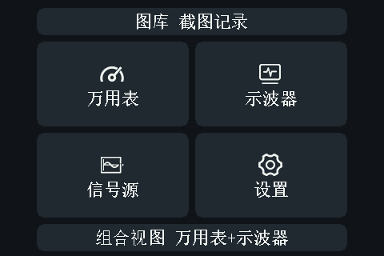
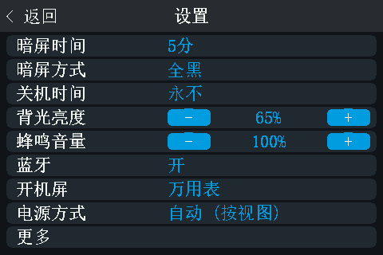
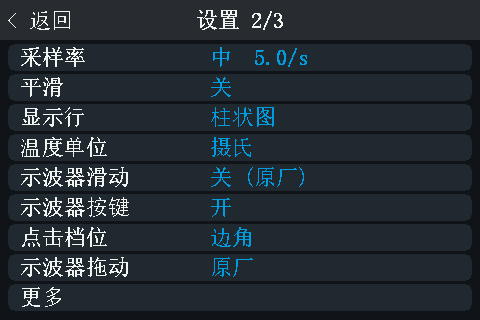
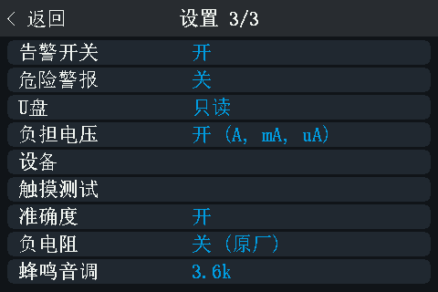
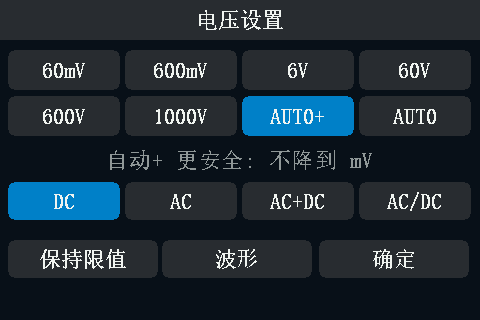
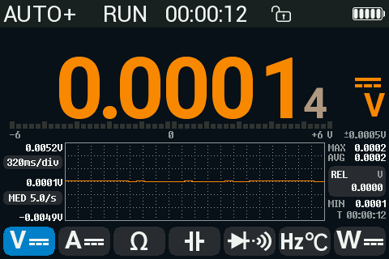
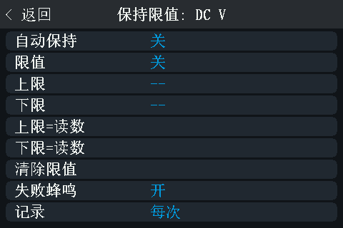
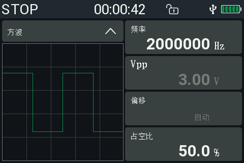
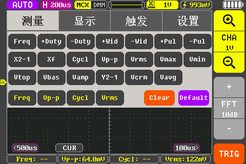

# OpenDM40-Chinese

[opendm40](https://github.com/opendm40/opendm40) 开源万用表固件的**简体中文汉化**，
面向正点原子 **DM40A / DM40B / DM40C**，基于 **v0.3.0** 源码。

已在 **DM40A 真机**上测试通过。

> opendm40 官方只有英文界面。本项目把主菜单、设置页、量程页等改为中文，
> 并提供一份完整的中文使用说明书。

---

## 效果

| 主菜单 | 设置 1/3 |
|---|---|
|  |  |

| 设置 2/3 | 设置 3/3 |
|---|---|
|  |  |

| 量程页 | 测量页 |
|---|---|
|  |  |

| 限值页 | 信号源 |
|---|---|
|  |  |

| 示波器（MF 菜单） |
|---|
|  |

> 示波器汉化的是**页签**（测量 / 显示 / 触发 / 设置）——`SC_F22` 就是 `TEXT22`，
> 所以不额外占字体。中间的测量项走 `SC_F16`、时间基准走 `SC_F12`，12–16 px
> 放不下汉字，保留英文。信号源侧的 `logic level` 走 `F14`，同理。

---

## 汉化范围

### 已中文

- **主菜单**全部 6 项：图库 截图记录 / 万用表 / 示波器 / 信号源 / 设置 /
  组合视图 万用表+示波器
- **设置三页**：26 个行标签 + 全部选项值
  （暗屏时间 5分 / 电源方式 自动 (按视图) / 显示行 柱状图 / U盘 只读 …）
- **量程页**：电压设置 / 电流设置 / 电阻设置 / **电容设置** / **二极管** /
  **频率/温度** / **功率设置**，自动+ 更安全：不降到 mV / 保持限值 / 波形 /
  确定 / 保险丝自检 / 涌流
- **温度设置页**：K热电偶 / PT100 / PT1000 / 10k 3950 / 10k 3435 / 100k 3950 /
  NTC自定义 / 单位: C / 偏移 / 点数值可输入 / 保持限值 / 确定 / **冷端 31.5 C**
- **万用表页传感器徽标**：K热电偶
- **功率计**：标题 功率设置 / 接线；状态行 **电流量程... / 电压校准...**；
  按钮 **电压校准 / 限值 / 确定**
- **限值页**：自动保持 / 限值 / 上限 / 下限 / 上限=读数 / 下限=读数 /
  清除限值 / 失败蜂鸣 / 记录，标题 `保持限值: DC V`，值 开 / 关
- **记录页**：间隔 / 时长 / 可用 / 每次 / 1分 / 手停 / 1小时 …
- **信号源**：频率 / 偏移 / 波形名 **正弦 / 方波 / 三角 / 上升**
- **示波器页签**：测量 / 显示 / 触发 / 设置
- **各页标题与返回键**：设置 / 量程 / 键盘 / 设备 / 记录 / 图库 / 帮助 /
  涌流 / 触摸测试 / 温度设置 / 功率设置 / 功率计接线 / `↩ 返回` / 删除 / 无数据

### 仍为英文（有意保留）

| 位置 | 内容 | 原因 |
|---|---|---|
| 测量页小标签 | MAX AVG MIN REL 320ms/div MED 5.0/s | 该处用 F14 字体（14 px / 1 bpp），行距仅 12 px。中文在 14 px 放不下，降到 11 px 后笔画糊成一团（见 screenshots/时间基准-11px失败样例.png） |
| 状态栏 | AUTO+ RUN HOLD | 该处用 F21 字体（21 px **4 bpp**），约 110 字节/字，且属通用符号 |
| 示波器正文 | Freq +Duty Cycl Clear Default FFT 10dB … | 这些走 SC_F12 / SC_F16 / SC_F20（12/16/20 px），汉字在 12–16 px 必糊；仅 20 px 面板按钮理论上可做，需另建一套字形表 |
| 信号源的 logic level | Vpp / 偏移 框右上角的小注 | 走 F14（14 px、行距 12 px），与 MAX/AVG/MIN 同源限制 |
| 单位与标准缩写 | 60mV 6V AUTO+ DC/AC/AC+DC Vpp PT100 | 本身就是符号与传感器型号 |
| 少量值 | Irms 100 ms Peak Duty No data Fast Reset Wh 之外 | 为放下其余译文而回退 |

**帮助页已完全移除**（设置 2/3 里的那一行也去掉了）。
它原本是 7 页英文速查，汉化过程中逐步减到 1 页 4 行，最后整页删除——
内容在 docs/opendm40-中文使用说明书.md 里更完整。

---

## 刷机教程

> ⚠️ **实测结论**：在 v0.3.0 上，
> ①「把升级文件拷进 U 盘等表弹窗」和 ②「关机时长按电源键进加载器」
> **这两条官方途径都不工作**。只能用 USB SCPI。

### 1. 准备 USB 驱动

Windows 自带没有 USBTMC 驱动，设备管理器里该设备显示为「其他设备 · 代码 28」。

1. 下载 [Zadig](https://zadig.akeo.ie/)
2. **以管理员身份运行** → `Options` → `List All Devices`
3. 下拉列表里找到 **`DM40 multimeter (opendm40)`**，会显示两个条目：
   - **`(Interface 0)`** ← **选这个**（仪器接口）
   - `(Interface 1)` ← 不要选，那是大容量存储
4. 目标驱动选 **`WinUSB`** → `Install Driver`

### 2. 准备 Python 环境

```bash
pip install pyvisa pyvisa-py pyusb libusb-package
```

### 3. 刷入

表通过 USB 连上电脑，运行：

```bash
python tools/upload_zh.py firmware/opendm40-v0.3.0-zh.bin --update --wait 120
```

它会：

1. `DBG:UPLOAD:BEGIN <len>,<crc32>`
2. 分块 `DBG:UPLOAD:DATA <offset>,<232 字节>` 传 634 KB，约 9 秒
3. `DBG:UPLOAD:END?` —— **表自己重新读取文件并校验 CRC-32**
4. `DBG:UPDATE` —— 清零加载器标记并复位，原厂加载器安装固件

设备会掉出 USB 约 1 秒，随后出现即为新固件。

### 4. 验证

```bash
python tools/dm.py --query 'DBG:BOOT?'
```

返回的加载器标记应与镜像头部一致（本项目为 `0xA0F25F0D 0x0009ADF4 0x000109A2`）。

也可以插上 USB，检查 `INFO/FIRMWARE.BIN` 的 SHA-256 是否等于所刷镜像。

### 5. 截屏（可选）

```bash
python tools/shot.py out.png
```

---

## 回退

用同样的工具，换镜像即可：

```bash
# 回官方英文版
python tools/upload_zh.py firmware/opendm40-v0.3.0-official.bin --update --wait 120

# 回正点原子原厂固件（有中文界面）
python tools/upload_zh.py firmware/dm40_v_2_6-stock.bin --update --wait 120
```

**刷固件从不改动标定区**（`0x080C0000`），所以回退后测量精度不变。

> 无论如何，**装好 opendm40 后第一件事是把 U 盘里的 `INFO/` 整个拷走**。
> 里面的 `CALIB.BIN`、`BOOTDATA.BIN`、`UID.BIN` 是这台表独有、**无法重建**的。

---

### 弹窗与提示改用 TEXT22

原版所有 toast 和对话框走 ASCII26（26 px **4 bpp**），一个汉字约 150 字节。
本项目把它整块换成 TEXT22（22 px 1 bpp）：

- 汉字成本从 150 降到 **64 字节**
- ASCII26 的 6,279 字节位图从 region A2 释放，960 字节条目从 B 释放
- 代价：弹窗文字**小一号**（26 px -> 22 px）

腾出的空间用来汉化：

- 对话框按钮 **是 / 否 / 取消 / 开始 / 再次 / 确定**
- 对话框标题与正文，例如保险丝自检的
  **表笔从 V/Ω 插孔接到 A / 其他不要接**、
  **测量中 ... / 应约 48 欧**、**保险丝正常 / 保险丝已断**、
  **OL: V 到 A 不通 / 更换 10A 陶瓷保险丝**、**检查表笔**
- 约 20 条提示，例如 **正在记录 / 无数值可记录 / 请先停止记录 /
  正在保存... / 磁盘忙, 请重试 / 触点校准已保存 / 电流过大, 请降低**

### 暗屏方式与超时档位

刻意新增的功能（不是原版行为）：

- **暗屏方式**：全黑（默认，背光 0）或 微光（背光 5%，原版行为）
- **暗屏时间**：15秒 / 30秒 / 1分 / 2分 / **5分** / 10分 / 30分 / 永不
- **关机时间**：1分 / 5分 / 10分 / 30分 / 1小时 / 2小时 / 永不

触摸、任意按键或电源键都能立即唤醒；唤醒逻辑原版已有，本项目只把暗屏
从「降到 5%」改成「按设置全黑或微光」。

设置值存在 p[0] 的第 15 位（0 = 全黑），超时索引从 2 位扩到 4 位以放
下 8 档，因此**升级后旧存档的档位会重新映射一次**，需要重新选一遍。


### 蜂鸣音调（新增）

蜂鸣器由 TIM14 的 PWM 驱动，音量就是占空比：uzz_k(100) = 0.495，也就是
**49.5%**，方波能携带的最大交流量——源码注释称这是「原厂能驱动的最大值」。
所以**音量参数已经到顶，没有软件余量了**。

真正剩下的杠杆是**驱动频率**：蜂鸣片只有接近谐振点才能输出额定声压，
偏离时可能低好几个 dB。原厂固定在 3.57 kHz（BUZZER_ARR = 11200，
TIM14 时钟 40 MHz）。

新增设置项 **蜂鸣音调**（设置 3/3）：

    2.7k / 3.0k / 3.6k / 4.0k / 4.5k      默认 3.6k（与原厂一致）

每按一次切换一档，并**立即响一声**，用耳朵挑最响的一档即可。
存 p[0] 第 16..19 位（0 = 未设，按 3.6k）。

如果五档里没有一档更响，说明这批蜂鸣片的谐振点就在 3.57 kHz 附近，
那就是硬件上限，软件无法再提升。


### 弹窗（toast）文案

改用 TEXT22 之后，绿色/红色的气泡提示也一并汉化：

| 触发 | 文案 |
|---|---|
| 点读数切采样率 | **中 5.0/s, 附加位 1.6 s** |
| 三指下滑截图 | **已存 S001.BMP**（文件名保持 ASCII） |
| 开始/停止记录 | **正在记录** / **已存 LOG000.DLG** |
| 触摸校准 | **触摸校准已保存** / **触摸校准已复位** |
| 磁盘异常 | **磁盘已满** / **无磁盘** / **磁盘忙** / **截图失败** / **记录失败** |
| 其它 | 正在保存... / 保存出错 / 请重插 USB 生效 / 正在安装固件... |

采样率的**档名**用单独的 UI 表（慢/中/快），dmm::RATE_NAMES 仍是 ASCII——
它会被写进 SCPI 回复，不能改成中文。


### 设置页：单页上下滑动

原来每页 9 行、行高 27 px、共 3 页，最后一行是「更多」。现在：

- **一页到底**：25 项在同一个列表里，屏幕显示 5 行
- **行高 42 px**（行距 46），汉字明显变大
- **上下滑动翻动**：上滑看后面的项，下滑回前面的项，**一次一行**
- 底部中间显示当前位置，例如 `2-6/25`
- 到第一项 / 最后一项就滑不动了（不循环）
- 背光亮度 / 蜂鸣音量仍是「-/+」步进键，跟着行高自动对齐

标题栏「< 返回」直接退出到菜单；MENU 键同样退出。

#### 尝试过「跟手无极滑动」，已回退

做过一版按像素跟手的滚动（拖动时列表随手指移动，不再是整行跳）。
实测问题太多，已撤掉：

- 拖动时每个事件都重绘整页，**屏幕狂闪**（只把重绘限制到列表带 + 6 px
  节流后仍不够）
- 列表带只有 230 px 高，第 6 行放不下，滑到一半时**首行或末行会整行消失**
- 回到顶部时上方残留没清干净

结论：在这块屏 + 这个刷新方式下，一次性重绘的范围太大，跟手滚动做不干净。
现在的「一次一行」滑动没有闪烁，首末行都在。

顺带给 `DBG:SWIPE` 加了 `U`（上滑），原来只支持 `L` / `R` / `D,n`。

### 图库：勾选式批量删除

网格底部栏中间（页码位置）点一下进入选择模式：

| 位置 | 选择模式下的作用 |
|---|---|
| 标题栏左「< 取消」 | 退出选择模式 |
| 标题栏右「删除」 | 删除所有勾选项。**就是查看器那个按钮**：同一个 `DEL` 矩形、同一个 `D_RED` 红色、同一段绘制代码；始终红色，不随勾选数量变化（截图像素实测两态都是 RGB 176,20,16）|
| 底部「<」「>」 | 翻页，勾选会保留 |
| 底部中间数字 | 已勾选数量 |
| 缩略图 | 点一下切换勾选，勾中画青色边框 |

截图（.BMP）和记录（.DLG）都能勾选、都能删；勾选按页保存，翻页不丢。
删完自动重扫并退回网格。

**没有二次确认框**：图库的两套对话框在这台机器上收不到点击——画面会
冻在对话框上，连 MENU 键都不再重绘，只能复位。为不把表锁死，点「删除」
立即执行。

### 跨页勾选

勾选**按页保存**（`sel: [u8; 4]`，4 页 × 6 格 = 24 个文件），勾选跟着文件走，
翻页不会丢，也不会跑到新一页同样的格子上。删除时逐页重新扫描目录，
从最后一页往前处理（删前面的页会让后面的页号前移）。

真机验证（7 个文件、两页）：第 1 页勾 2 个、翻到第 2 页勾 1 个，计数显示 3，
点删除后 7 → 4，三个都删掉了，`DBG:BOOT?` = NONE。

#### 曾经的两个坑

1. **只删掉一页**
   `page_scan()` 里有一句 `if self.mode != Mode::Grid { return; }`。批量删除
   是在对话框模式下跑的，所以重扫虽然执行了，**结果没有写回 `ents`**；
   第二遍拿的还是上一页的文件名，删不到就返回 `NotFound`，而删除循环把
   `NotFound` 当成"已经删掉了"，顺手把勾选也清了。
   计数说 3 个、实际只少 2 个，就是这么来的。
   修法：进 `delete_selected` 先 `self.mode = Mode::Grid`。

2. **翻页会删错文件**（更早的版本）
   勾选是页内序号，翻页后同样的位置看起来已勾选，删除就会删错。
   现在按页存，不存在这个问题。

查看器里 BMP 的详细信息（`BMP with 24 bits per pixel, compression 0`）
仍是英文：那一行用 14 px 字体，没有汉字字形。

### 已知问题：查看器正文不渲染（上游代码，本次未改动）

在图库网格上点一张截图，**顶部栏是对的**（名称、序号、删除按钮都在），
但正文一直是上一次画面的残留像素，图片本身没画出来。记录（DLG）同样。

排查结论：

- `fn view()` / `paint_all()` 的 `Mode::View` 分支与上游逐行一致：
  用 `difflib` 对比 `_pristine` 的 `gallery.rs`，查看器相关只有一行差异，
  就是下面那次失败的尝试，已经撤掉。
- 撤回后重新编译，产物与仓库里的固件 **SHA-256 完全相同**（`40183f97…`），
  不存在"源码和固件不一致"。
- 因此这一项不是批量删除改动引入的，是上游在这台机器上的既有表现
  （和更早发现的"对话框收不到点击"可能是同一类状态问题）。

试过的错误修法：在 `view()` 里补 `self.need |= N_CUR;`，结果整屏变黑、
连顶部栏也不画，已撤回。正文到底由哪个条件触发还没查清，不要再猜着改。

不影响勾选、翻页、批量删除：这些都在网格里，实测正常。

### patch/ 说明

按顺序作用在 **opendm40 v0.3.0 原始源码**上：

| 脚本 | 作用 |
|---|---|
| `mkpatch2.py` | 设置页标签 + 主菜单 + `view_name` |
| `mkpatch4.py` | 设置页的值（`app.rs` / `meter.rs` / `scope_ui.rs` / `scope_page.rs`） |
| `mkpatch5.py` | 危险警报值 + 采样率显示名 |
| `mkpatch6.py` | 量程页标题 + 保持限值 |
| `mkpatch7.py` | 帮助页 7 → 4 页（腾闪存） |
| `mkpatch8.py` | `Wave` / `OK` / U盘值 / AUTO+ 提示行 |
| `derive_sets.py` | 从七个源文件的字符串字面量反推所需汉字 |
| `rebuild_fonts.py` | 按两种字体的各自编码约定重建 `TEXT22` / `F14` |

`mkpatch3.py` 是记录 F14 汉化失败经过的空操作，保留作说明。

---

## 从源码重建

需要 Rust 工具链（`thumbv7em-none-eabihf` + `llvm-tools`）与 git-bash。
Windows 上的几个坑（`RUSTUP_HOME` 要用 Windows 路径、`PATH` 要用 MSYS 路径、
`stackdepth.py` 缺 `.exe` 后缀）见 `docs/刷机与构建记录.md`。

```bash
git clone --depth 1 --branch v0.3.0 https://github.com/opendm40/opendm40.git
cd opendm40
python3 ../patch/mkpatch2.py firmware/src ...
# …… 按上表顺序应用 mkpatch4 ~ mkpatch8
python3 ../patch/derive_sets.py <vendor-cjk-set> firmware/src/*.rs
python3 ../patch/rebuild_fonts.py --pristine ... --out firmware/src/stockfont_data.rs ...
firmware/build.sh
```

### 闪存余量（很紧）

| 区域 | 剩余 | 硬性下限 |
|---|---|---|
| B（零等待） | 8,576 字节 | 8,192 |
| C | 4,236 字节 | 4,096 |

实测：**一个 22 px 汉字在 B 区约占 64 字节**（50 字节位图 + 10 字节条目 + 对齐）。
B 区只剩 164 字节余量——想再加中文必须先腾出空间，
`patch/` 里的脚本和 `docs/` 的分析记录了每一步是怎么换来的。

---

## 字形是怎么来的

| 来源 | 数量 | 说明 |
|---|---|---|
| 原厂 V2.6 固件自带 | 94 个 | opendm40 已内嵌原厂位图字体，其中 TEXT22 含 216 个汉字，按字符串实际用字裁剪 |
| 宋体渲染补齐 | 144 个 | 原厂字集没有的字，用宋体 22 px 二值化后按原厂格式编码 |

### 三个必须对齐的地方

1. **编码约定**：TEXT22 的 h 是格子高度（恒 22），	 是墨迹首行，
   ih 是墨迹高度，yoff 恒 0。F14 相反：h 就是墨迹高度、	 恒 0、
   纵向位置放在 yoff。用错一套，字就会被裁掉一截。
2. **基线**：原厂 94 个汉字里有 84 个的墨迹底端落在第 20 行。手绘字最初
   一律「顶端对齐到第 1 行」，结果笔画短的字（如 上）悬空 2 像素。
   现在满高字的墨迹底端统一压到第 20 行——**142/144 手绘字与原厂落在同一基线上**。
3. **渲染画布**：宋体 22 px 的墨迹是 20 行，基线压在画布底边会把最后 2 行裁掉。
   正确做法是在放大画布上渲染、取墨迹包围盒后再贴进格子。


## 许可与来源

- **代码**：沿用上游 opendm40 的 **MIT**，见 [LICENSE](LICENSE)
- **上游项目**：[opendm40/opendm40](https://github.com/opendm40/opendm40)，MIT
- **中文字形**：64 个来自正点原子 DM40 V2.6 原厂固件的位图字体；
  69 个由宋体（SimSun）渲染得到
- `firmware/dm40_v_2_6-stock.bin` 是**正点原子官方固件，版权归其所有**，
  仅为方便回退而附带
- 本项目与正点原子（Alientek）无关，未获其授权或认可

> ⚠️ 如果你的用途对字体授权敏感（例如商业分发），建议把 69 个手绘字形
> 改用 OFL 授权的开源字体（如 Noto Sans SC / 思源黑体）重新渲染后重编。

---

## 免责声明

刷第三方固件**可能失去原厂保修**，也存在变砖风险。opendm40 的设计
（不动 bootloader、不动标定区、升级失败停在加载器）把风险压到很低，
但**请自行承担后果**，并务必先备份 `INFO/`。

opendm40 上游标注其状态为 **Experimental**：只在一台 DM40A 上实测，
DM40B / DM40C 仅在模拟器验证。涉及 A 插孔通电流的功能未上真机。
